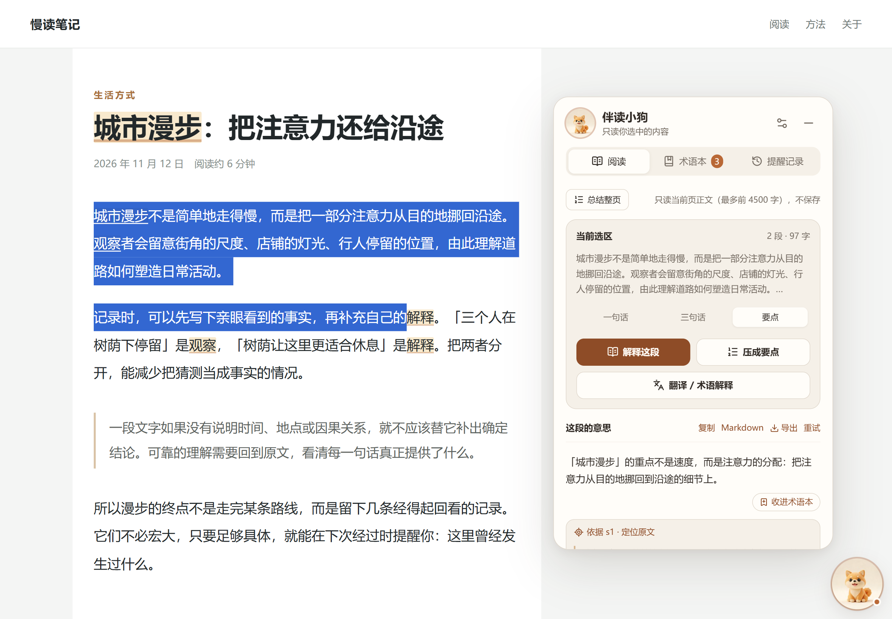
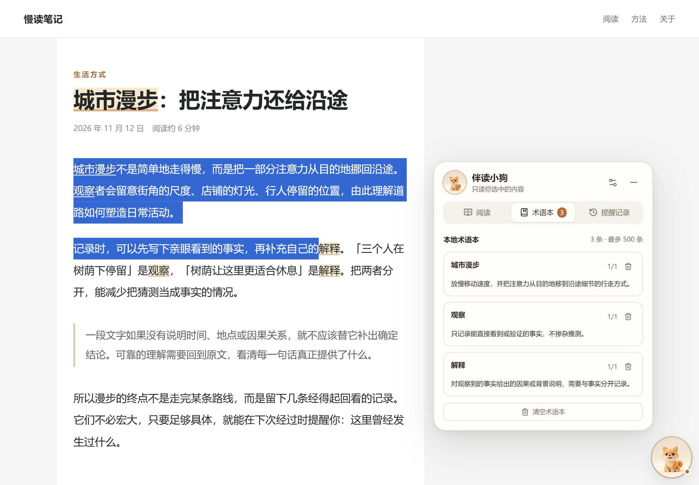
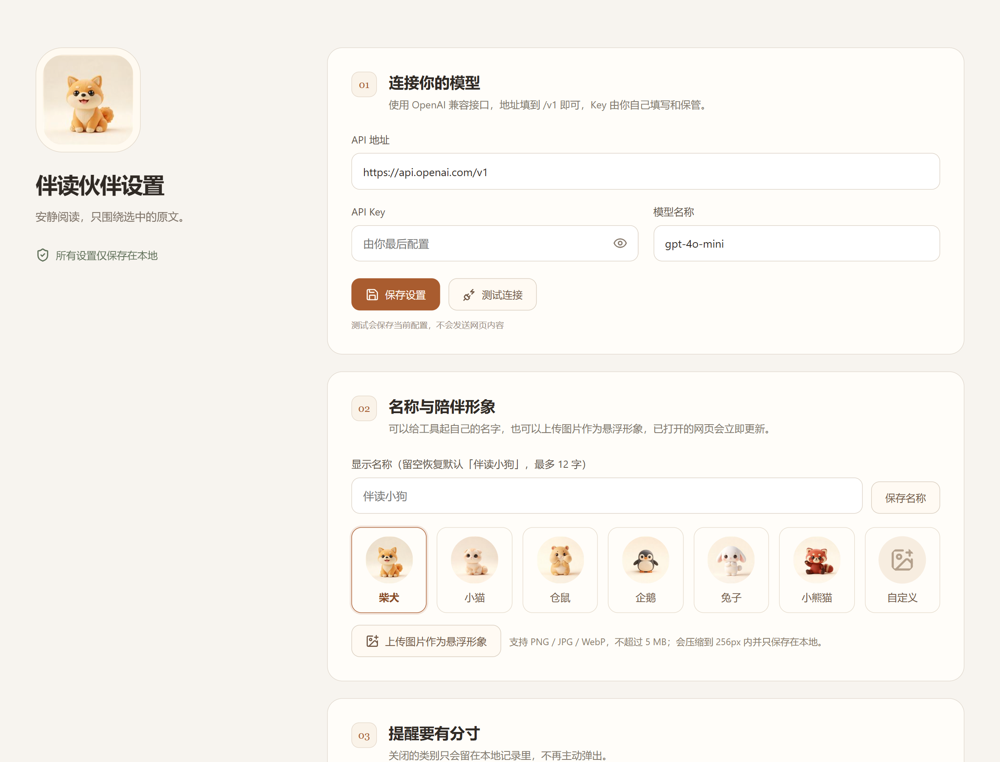

# 🐶 伴读小狗 · page-pup

> 🌤️ 只围绕你选中的原文解释和提炼，安静地陪你读网页。

🧩 一个运行在 Chrome / Edge 里的伴读扩展（Manifest V3）。它会变成一只安静的小狗待在网页角落：
你划词，它解释、压要点、翻译，并且每条结论都附上原文依据。没有后端服务，模型用你自己配置的
OpenAI 兼容接口，所有数据只存在本地浏览器。



## ✨ 功能

### 🔍 划词解读，答案有据可查

- 🗣️ **解释 / 压要点 / 翻译** 三种操作，长度可切「一句话 / 三句话 / 要点」。
- 📌 每条结论都绑定原文片段，点开就能看到依据，避免模型自由发挥。
- 🛡️ 选区过长或结构过于琐碎时会直接提示，而不是硬塞给模型。

### 📄 整页总结

- 📚 一次读完整页正文（最多 4500 字，最多 6 段），只在点击时读取，不缓存页面内容。

### ⚡ 流式输出

- 💬 回答边生成边显示，随时可以中断；后台通过端口转发 SSE，页面不会卡住。

### 📒 本地术语本

- 🔖 一键把术语和释义存进本地术语本，最多 500 条，超出自动淘汰最旧的。
- 🖍️ 在启用的网站上自动做全页高亮，悬停出现释义卡，可以就地删除。
- 📤 支持导出 **JSON** 和 **Markdown**，方便整理进自己的笔记。

### 🔔 有分寸的提醒

- ⏰ 四类提醒：长时间阅读、表单填写停顿、页面报错、休息提醒（30 / 45 / 60 分钟可选）。
- 🎛️ 可整类静音、可设置冷却、你在操作时会自动延后，不打断当前输入。
- 🗂️ 提醒记录保留最近 100 条（含被静音、冷却忍住的那些），方便回看。

### 🐾 陪伴形象

- 🐕 六款内置形象：柴犬、小猫、仓鼠、企鹅、兔子、小熊猫。
- 🎨 可以改名字（最多 12 字），也可以上传自己的图片当悬浮形象，已打开的网页立即更新。

### 🪟 悬浮窗交互

- 🖐️ 拖拽移动，位置按站点分别记忆；双击收起 / 展开。
- 😴 闲置 2 分钟进入休眠（缩小变淡 + Zzz），指针移上去自动醒来。
- 💭 随机待机小动作、思考时的「…」气泡。

## 🖼️ 界面预览

| 🔍 划词解读 | 📒 本地术语本 |
| --- | --- |
|  |  |

⚙️ 设置页（模型、形象、提醒、术语本）：



## 🚀 快速上手（普通用户）

🌱 不用装 Node，也不需要写代码，按下面五步走完就能用。

### 📦 第 1 步：下载扩展包

1. 打开 [Releases](https://github.com/yezbjye/page-pup/releases/latest) 页面；
2. 下载最新的 `page-pup-x.y.z-chrome.zip`；
3. 解压到一个**固定目录**（例如 `D:\Apps\page-pup`）。

> ⚠️ 解压后的文件夹就是扩展本体，加载后不要删除或移动它，否则扩展会失效。

### 🧩 第 2 步：在浏览器里加载扩展

**🟦 Chrome**

1. 地址栏输入 `chrome://extensions` 并回车；
2. 打开右上角的「开发者模式」开关；
3. 点左上角「加载已解压的扩展程序」；
4. 选择第 1 步解压出来的文件夹（**里面有 `manifest.json` 的那一层**）；
5. 列表里出现「伴读小狗」即加载成功。

**🟩 Edge**

1. 地址栏输入 `edge://extensions`；
2. 打开左下角「开发人员模式」；
3. 点「加载解压缩的扩展」，选择同一个文件夹。

📌 **建议顺手固定图标**：点浏览器工具栏的拼图图标 → 点「伴读小狗」旁边的图钉，之后就能一键打开。

### 🔑 第 3 步：填自己的模型

1. 点工具栏上的小狗图标；
2. 点弹窗底部的「设置 LLM 与提醒」；
3. 在「01 连接你的模型」里填写：
   - 🌐 **API 地址**：填到 `/v1` 为止，例如 `https://api.openai.com/v1`；
   - 🔐 **API Key**：你自己的 Key（只存在本机浏览器）；
   - 🤖 **模型名称**：例如 `gpt-4o-mini`；
4. 点「保存设置」，再点「测试连接」，看到成功提示就配置好了。

> 💡 Key 从你的模型服务商后台获取。没有账号也可以先用本地模型（例如 Ollama 的 `http://localhost:11434/v1`）。

### 🌐 第 4 步：让小狗出现在网页上

1. 打开一个你想阅读的网页（新闻、博客、文档都行）；
2. 点工具栏上的小狗图标；
3. 只想在这个网站用：点「仅在此网站启用」；想在所有网站用：点「在所有网站启用」；
4. 浏览器会弹出权限确认，点「允许」；
5. 页面右下角出现小狗，说明已经就绪（没出现就刷新一下页面）。

> ⚠️ `chrome://`、扩展商店等浏览器内置页面无法注入，这是浏览器的限制。

### 📖 第 5 步：开始阅读

1. 用鼠标选中一段文字；
2. 浮窗出现后，点「解释这段」「压成要点」或「翻译 / 术语解释」；
3. 想要整页摘要，点浮窗里的「总结整页」；
4. 觉得某个术语重要，点结果下方的「收进术语本」，之后它会自动在页面上高亮；
5. 双击小狗可以收起成小圆点，再双击展开；按住拖动可以换位置。

⏸️ 不想在某个网站看到它：点扩展图标 → 「在此网站暂停」（其他网站不受影响）。

### 📋 交互小抄

| 操作 | 效果 |
| --- | --- |
| 🖱️ 选中文字 | 弹出解读浮窗 |
| 👆 双击小狗 | 收起 / 展开面板 |
| 🖐️ 按住拖动 | 移动位置（按站点记忆） |
| 😴 闲置 2 分钟 | 休眠成半透明小图，指针移上去自动醒来 |
| 🧩 点扩展图标 | 启用 / 暂停当前网站、进入设置 |
| 🖍️ 悬停高亮词 | 显示术语释义卡 |

## ⚙️ 配置详解

### 🔌 1. 连接模型（设置页 01）

| 配置项 | 说明 |
| --- | --- |
| 🌐 API 地址 | OpenAI 兼容地址，填到 `/v1` 即可，例如 `https://api.openai.com/v1` |
| 🔐 API Key | 你自己的 Key，只保存在本地浏览器 |
| 🤖 模型名称 | 例如 `gpt-4o-mini`，填服务商实际的模型 ID |

🧾 可用的服务（只要满足下面几点都可以）：

- ✅ 实现了 `POST {API 地址}/chat/completions`；
- ✅ 支持 `Authorization: Bearer <API Key>`；
- ✅ 支持 `response_format: { "type": "json_object" }` 和 `stream: true`。

🧪 常见配置示例：

| 服务 | API 地址 | 模型名称示例 |
| --- | --- | --- |
| OpenAI | `https://api.openai.com/v1` | `gpt-4o-mini` |
| DeepSeek | `https://api.deepseek.com/v1` | `deepseek-chat` |
| 本地 Ollama | `http://localhost:11434/v1` | `qwen2.5:7b` |

> 💡 本机地址允许使用 HTTP，其余地址必须是 HTTPS。模型名和地址请以服务商文档为准。

### 🌐 2. 启用站点

- 🎯 **仅在此网站启用**：只给当前站点授权，只有它会注入浮窗；
- 🌍 **在所有网站启用**：一次授权全部站点，之后可以在任意站点单独暂停；
- ⏸️ 暂停只影响当前站点，其他站点不受影响。

🔒 内容脚本按需注入（`activeTab` + 可选站点权限），没有授权的网站不会运行任何脚本。

### 🎨 3. 名字与形象（设置页 02）

- ✏️ 显示名称留空则恢复默认「伴读小狗」，最多 12 字；
- 🖼️ 可上传一张图片作为自定义形象（PNG / JPG / WebP，不超过 5 MB，会自动压缩到 256px）。

### ⏰ 4. 提醒（设置页 03）

- 🎛️ 四类提醒可分别开关；休息提醒可选 30 / 45 / 60 分钟；
- ⏱️ 长时间阅读的触发阈值可选 1 / 3 / 8 分钟；关闭的类别只留在记录里，不再主动弹出。

### 📒 5. 本地术语本（设置页 05）

- 📤 查看条目总数，导出 JSON / Markdown；
- 🖍️ 全页高亮只在你启用的站点生效，卸载扩展或关闭开关后不留残留节点。

## 🛠️ 从源码构建（开发者）

```bash
git clone https://github.com/yezbjye/page-pup.git
cd page-pup
npm install
npm run build
```

🧩 然后在 `chrome://extensions` 里「加载已解压的扩展程序」，选择 `.output/chrome-mv3`。

🔥 开发模式（热更新）：

```bash
npm run dev
```

📦 需要打包 zip（例如上传商店）时执行 `npm run zip`，产物在 `.output/` 下。

## 🔐 权限说明

| 权限 | 用途 |
| --- | --- |
| `activeTab` | 在你点击时临时访问当前标签页 |
| `scripting` | 按需注入内容脚本（浮窗），不在所有页面常驻 |
| `storage` | 保存设置、站点启用状态、术语本、提醒记录与浮窗位置 |
| `tabs` | 读取当前标签页地址，判断是否已启用，并在启用后刷新已打开页面 |
| 可选站点权限 `https://*/*`、`http://*/*` | 只在你选择「在当前网站 / 所有网站启用」时申请 |

## 🛡️ 隐私

- 🚫 **没有后端**：项目不包含任何服务器代码，也没有统计与埋点。
- 🔑 **Key 本地保存**：API Key、设置、术语本、提醒记录都只写入 `chrome.storage.local`。
- 📨 **只发送必要内容**：只有你选中的文字或你主动点击「总结整页」时的正文，会发送到你配置的 API 地址。
- 🧱 **浮窗样式隔离**：界面跑在 Shadow DOM 里，不受网页样式影响，也不会污染网页样式。

## 💻 开发

```bash
npm run dev        # 开发模式（HMR）
npm run build      # 构建到 .output/chrome-mv3
npm run zip        # 打包 zip
npm run test       # vitest 单元测试
npm run typecheck  # TypeScript 严格模式检查
```

🧰 技术栈：WXT 0.21 + React 19 + TypeScript（strict）+ lucide-react，Manifest V3，Shadow DOM 隔离。

### 🗂️ 目录结构

```
entrypoints/
  background.ts        # 后台：端口通信、SSE 流式转发、提醒与标签页管理
  content/index.tsx    # 内容脚本：挂载 Shadow DOM 浮窗
  popup/               # 工具栏弹窗：站点启用 / 暂停
  options/             # 设置页：模型、形象、提醒、术语本
components/pup/
  PupApp.tsx           # 浮窗主体：划词、阅读、术语本、提醒、拖拽与休眠
  Pet.tsx              # 宠物形象与思考气泡
  styles.css           # 浮窗样式（Shadow DOM 内）
  glossaryHighlight.ts # 页面内术语高亮与释义卡
shared/                # 类型、存储、LLM 请求、SSE 解析、选区/页面提取等
tests/                 # vitest 单元测试与页面 fixture
public/pets/           # 内置宠物形象
docs/screenshots/      # README 截图
```

## ❓ 常见问题

**📁 加载扩展时提示「清单文件缺失或不可读取」？**
选错层级了，要选**直接包含 `manifest.json`** 的那个文件夹。

**🔍 浮窗没有出现？**
先确认当前站点已启用；`chrome://`、扩展商店等受限页面无法注入；启用后记得刷新页面。

**🔑 提示 API Key 无效 / 没有权限？**
检查 Key 是否填写完整、是否开通了对应模型，以及地址是否以 `/v1` 结尾。

**🌐 提示 HTTP 404？**
多半是 API 地址或模型名称不对，两者要和服务商文档一致。

**⏳ 提示请求过于频繁 / 额度不足？**
服务商限流或余额不足，稍后再试或更换模型。

**💬 回答内容为空？**
模型需支持 `json_object` 输出；部分小模型或本地模型不支持时请换用其他模型。

**⚙️ 设置在哪打开？**
点扩展图标 → 「设置 LLM 与提醒」，或在 `chrome://extensions` 里点「扩展程序选项」。

## 📜 许可证

📄 [MIT](LICENSE)
